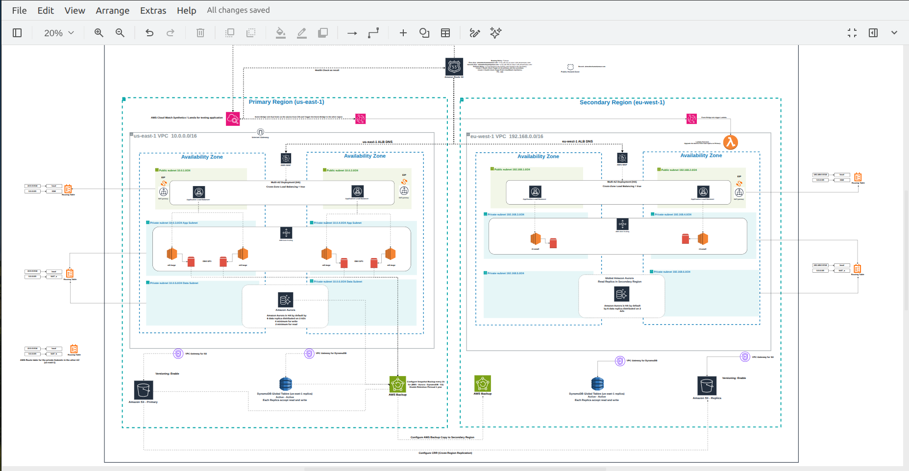

# AWS Multi-Region Disaster Recovery Architecture

This project shows how to keep a web application available if the
primary AWS Region fails. It uses `us-east-1` as the primary Region and
`eu-west-1` as the secondary Region.

## Disaster Recovery Strategies

AWS has 4 common DR strategies. The main difference is the cost and
how quickly the application can recover.

#### Backup and Restore
- Restore application and data from backups after a disaster.
----------------------------------------------------
#### Pilot Light
- Keep the core medium to long data and a few important resources running. Scale up the rest during recovery.
----------------------------------------------------
#### Warm Standby
- Keep a smaller Short to medium Medium version of the application running in the secondary Region. Scale it up during failover.
----------------------------------------------------
#### Multi-Site (Active/Active)
- Run the Very short High Active/Active application in multiple Regions and send traffic to all of them.
----------------------------------------------------
**Note:** This project uses **Warm Standby**. The secondary Region has a
running environment and replicated data, and Route 53 can send users
there when the primary Region becomes unhealthy. The actual recovery
time and data loss depend on the configuration and must be tested.

## Table of Contents

-   [Architecture Overview](#architecture-overview)
-   [AWS Regions and Network Design](#aws-regions-and-network-design)
-   [Application Traffic Flow](#application-traffic-flow)
-   [Disaster Detection and Failover](#disaster-detection-and-failover)
-   [Data Protection and Replication](#data-protection-and-replication)
-   [Backup and Retention](#backup-and-retention)

## Architecture Overview

The project uses two AWS Regions:

  ------------------------------------------------------------------------
  Role              Region            VPC CIDR           Purpose
  ----------------- ----------------- ------------------ -----------------
  Primary           `us-east-1`       `10.0.0.0/16`      Main application

  Secondary         `eu-west-1`       `192.168.0.0/16`   Warm standby and
                                                         replicated data

The VPC CIDRs do not overlap.

## AWS Regions and Network Design

### Primary Region: `us-east-1`

The primary VPC is `10.0.0.0/16` and uses two Availability Zones.

  Subnet                  CIDR            Purpose
  ----------------------- --------------- ---------------------------
  Public subnet A         `10.0.1.0/24`   Public-facing resources
  Public subnet B         `10.0.2.0/24`   Public-facing resources
  Private app subnet A    `10.0.3.0/24`   Application EC2 instances
  Private app subnet B    `10.0.4.0/24`   Application EC2 instances
  Private data subnet A   `10.0.5.0/24`   Database subnet group
  Private data subnet B   `10.0.6.0/24`   Database subnet group

The diagram uses `m5.large` as the initial application instance size.
The final size should be tested against expected traffic and cost.

### Secondary Region: `eu-west-1`

The secondary VPC is `192.168.0.0/16` and also uses two Availability
Zones.

  -----------------------------------------------------------------------
  Subnet                  CIDR                    Purpose
  ----------------------- ----------------------- -----------------------
  Public subnet A         `192.168.1.0/24`        Public-facing resources

  Public subnet B         `192.168.2.0/24`        Public-facing resources

  Private app subnet A    `192.168.3.0/24`        Standby application
                                                  instances

  Private app subnet B    `192.168.4.0/24`        Standby application
                                                  instances

  Private data subnet A   `192.168.5.0/24`        Database subnet group,
                                                  if needed

  Private data subnet B   `192.168.6.0/24`        Database subnet group,
                                                  if needed
  -----------------------------------------------------------------------

The diagram uses `t3.small` as the initial standby instance size. Check
whether it can handle the production workload after failover.

### Network notes

-   Public subnets use routes to an Internet Gateway.
-   Private application subnets use NAT Gateways when they need outbound
    internet access.
-   S3 and DynamoDB gateway endpoints can reduce the need to send
    supported service traffic through NAT.
-   Security groups should allow only the required traffic between the
    ALB, application, and database.
-   A subnet is not public just because the VPC has an Internet Gateway.
    Its route table and addressing must also be configured correctly.

## Application Traffic Flow

During normal operation:

1.  The user opens the application domain.
2.  Route 53 returns the primary ALB while the primary record is
    healthy.
3.  AWS WAF filters requests associated with the protected ALB.
4.  The ALB sends requests to healthy EC2 instances in the Auto Scaling
    group.
5.  The application accesses Aurora and DynamoDB using the required
    permissions and network rules.
6.  Application objects are stored in S3 and replicated to the secondary
    Region.

The ALB should use at least two Availability Zones, and the application
should have healthy targets in both AZs.

## Disaster Detection and Failover

### 1. Detect the failure

Use a CloudWatch Synthetics canary to test the application endpoint or a
simple user journey. The canary should check the expected response, not
only whether the endpoint can be reached.

CloudWatch alarms monitor the canary results. Set the alarm threshold
and evaluation periods to avoid triggering failover because of one
temporary error.

### 2. Connect the health check to Route 53

Route 53 can use a supported CloudWatch alarm as a health-check signal.
It can also check an endpoint directly when that is suitable.

Keep these checks separate: - **Application health:** Can users use the
application? - **Secondary readiness:** Can the standby Region serve
requests? - **Database health:** Does the database need failover?

A failed canary does not always mean the database has failed, so do not
promote Aurora just because the website has a problem.

### 3. Configure Route 53 failover

Create two failover alias records for the same application domain:

-   **Primary record:** Points to the `us-east-1` ALB.
-   **Secondary record:** Points to the `eu-west-1` ALB.

Associate the primary record with the primary health signal. Check that
the secondary application and its dependencies are ready before relying
on it.

A TTL of 60 seconds is a reasonable starting point for testing. Health-check detection, alarm
evaluation, DNS caching, and client behavior all affect the result.

### 4. Use EventBridge and Lambda for recovery

EventBridge can detect a CloudWatch alarm state change and start a
recovery workflow.

If an event in `us-east-1` must trigger a rule or event bus in
`eu-west-1`, configure cross-Region event delivery and the required
permissions.

A Lambda function in the secondary Region can: - Check whether the
failure requires recovery. - Check the standby application and its
dependencies. - Start Aurora Global Database failover when
appropriate. - Confirm that the new database writer is available. - Log
the recovery result and send notifications.

Make the workflow safe to run more than once, limit its IAM permissions,
and prevent two recovery executions from running at the same time.

## Data Protection and Replication

### Aurora Global Database

-   The primary Region contains the writer cluster.
-   The secondary Region contains a secondary cluster.
-   Data is replicated asynchronously between Regions.
-   During a disaster, follow the Aurora Global Database failover
    procedure.
-   Confirm that the new writer is available before sending write
    traffic to it.
-   Test application reconnection and record the actual recovery time
    and data loss.

### DynamoDB Global Tables

-   Configure replicas in both Regions.
-   Global Tables support reads and writes in multiple Regions.
-   Consider replication delay and updates to the same item from
    different Regions.
-   Test how the application behaves if a Region is unavailable.

Global Tables do not need the same manual promotion step as Aurora
Global Database.

### Amazon S3 Cross-Region Replication

-   Enable versioning on the source and destination buckets.
-   Configure the replication rule and required IAM permissions.
-   Monitor replication status.
-   Decide how deletes and object versions should be handled.
-   Plan how data will be synchronized during failback.

Replication is not a replacement for backups. Depending on the
configuration, unwanted changes or deletions can affect replicated data.

## Backup and Retention

The project proposes hourly recovery points and one-year retention.
Configure the backup plan separately for each service because their
backup features are different.

  -----------------------------------------------------------------------
  Resource                Backup approach         What to check
  ----------------------- ----------------------- -----------------------
  EBS                     AWS Backup or EBS       Schedule, retention,
                          snapshots               encryption, and restore

  Aurora                  Automated backups/PITR, Retention, recovery
                          AWS Backup, or          window, and restore
                          snapshots as            
                          appropriate             

  DynamoDB                Point-in-time recovery  Recovery window,
                          and/or AWS Backup       schedule, and restore

  S3                      Versioning, AWS Backup  Supported backup mode,
                          where configured, and   retention, and restore
                          other independent       
                          backup controls         
  -----------------------------------------------------------------------

Configure cross-Region backup copies where required. Check the
destination Region, encryption keys, permissions, and retention.

One-year backup retention does not mean one year of point-in-time
recovery. Check the limits of the selected backup method; use periodic
backups or another suitable approach for longer retention where needed.
